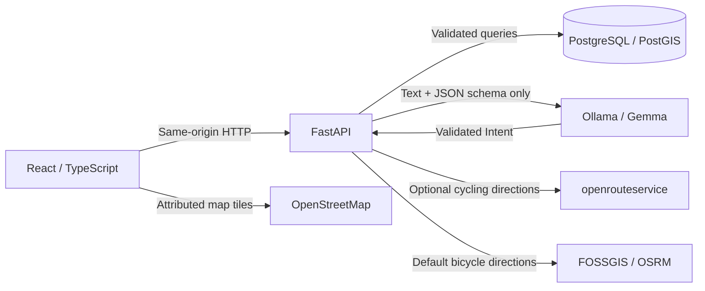

# Architecture

`app/schemas.py` defines strict request and model-output types. `app/ai.py` interprets text; it cannot access the database or execute code. `app/discovery.py` applies spatial and privacy constraints, retrieves existing records, and scores eligible cyclists. Scores renormalize the proposed 0.30 distance / 0.25 pace / 0.20 interests / 0.15 availability / 0.10 experience weights over specified dimensions. An entirely unspecified search has no compatibility percentage. Weights are product assumptions, not measured probabilities.

PostGIS `geography` columns and GiST indexes support meter-based radius queries. Profiles store approximate locations rounded to 0.01 degrees and public responses expose only the area. Blocks work in both directions. Undiscoverable profiles are not public. Route geometry is public only for CLI imports; provider-generated routes belong to their creator.

RSVP operations acquire `SELECT FOR UPDATE` on the event before checking capacity or changing membership. The event/user unique constraint also prevents duplicate rows. Creating a ride registers its organizer as attending. Capacity is calculated from real attending rows; interested RSVPs do not consume places. Ordinary discovery can display full events, while natural-language event recommendations exclude them.

Sessions use Argon2 password hashes and signed, expiring JWTs in HTTP-only same-site cookies. User lookup runs on every protected request, so deleting an account invalidates its sessions. Unsafe browser requests are checked for allowed origins and cross-site fetch metadata. Passwords, cookies, and model prompts are not intentionally logged. The app assumes a single local API instance; rate limits are per process.

Alembic creates the initial schema and PostGIS extension. For future schema changes, add explicit new revisions; never edit a revision after it has been applied. Seed insertion is idempotent and does not replace user-created data. Sample event dates are relative to first seeding, not refreshed on every startup.

All location-based searches use the explicitly selected area and radius. NLP distance means desired ride length. Destination direct distance does not estimate ride distance. Only a routing provider or imported route supplies route geometry. No road-access or route-safety guarantees are synthesized.

The map explorer layers actual route geometry and custom destination markers over OpenStreetMap or OpenTopoMap tiles. Cyclist marker placement uses an explicit table of public neighborhood reference points, independent of the stored profile coordinates. Zoom-dependent grouping merges nearby avatars without inventing positions. Unknown neighborhood names remain list-only. The floating UI and pointer-driven mobile sheet are separate from the map controller and from request transport.

Viewport search passes independently validated north/south/east/west bounds to FastAPI. PostGIS applies an envelope intersection alongside the meter-based radius condition before retrieval limits. A frontend request-generation counter rejects stale responses. Searching the current viewport preserves map position; choosing a named area recenters it.

`app/routing.py` validates provider responses against `ComputedRoute`. The default public OSRM bicycle service is throttled globally within the single local API process to one request per second. Route endpoints also enforce per-client request limits. Multiple API workers would require shared throttling or a dedicated/self-hosted provider. Gemma has no role in route geometry or distances.
